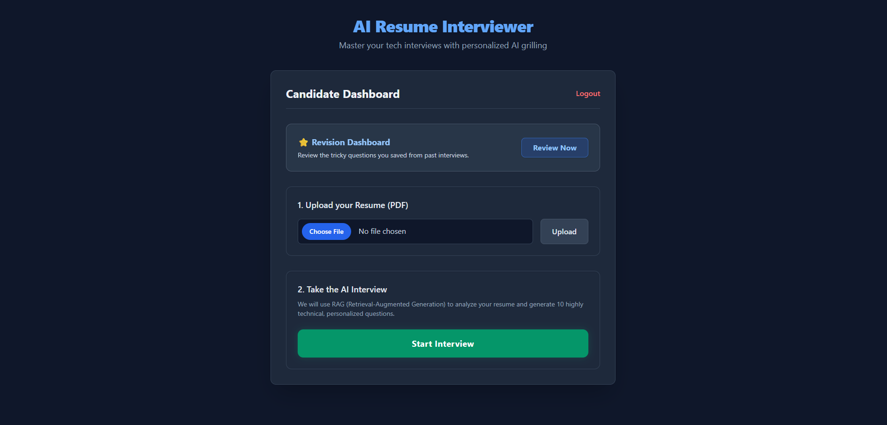
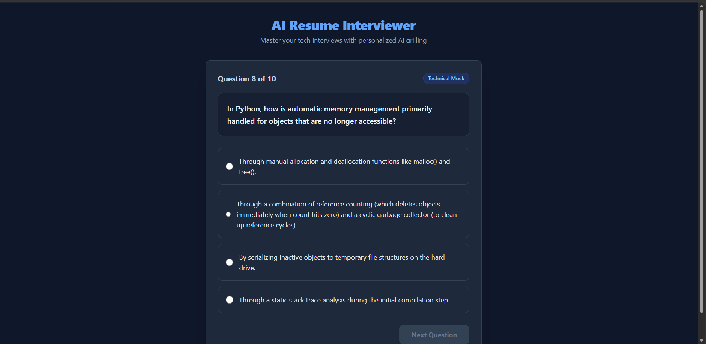
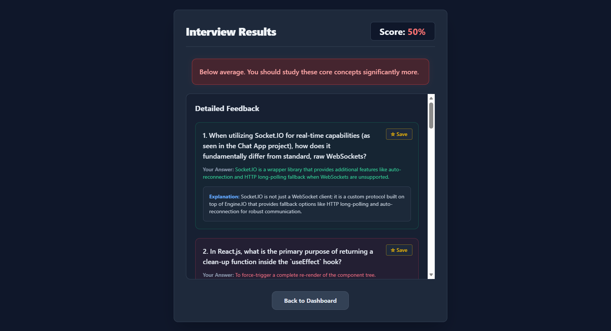

# AI Resume Interviewer 🎤📄

A small, beginner-friendly full-stack project that demonstrates a **real Retrieval-Augmented Generation (RAG) pipeline**: upload your resume, and an AI interviewer generates 10 personalized questions based *only* on retrieved resume content, scores your answers, and gives you a final report.

## How the RAG pipeline works

```
Upload PDF → Extract Text → Chunk Text → Generate Embeddings
→ Store in ChromaDB → Retrieve Top-K Chunks → Gemini Prompt
→ Generate Interview Questions
```

The LLM never sees your entire resume — only the specific chunks retrieved as most relevant. This is the core idea of RAG.

## Tech Stack

- **Frontend:** React (Vite) + React Router + Axios + Tailwind CSS
- **Backend:** Node.js + Express.js
- **Database:** MongoDB (users, resume metadata, interview history)
- **Vector DB:** ChromaDB (resume chunk embeddings)
- **Auth:** JWT + bcrypt
- **File Upload:** Multer
- **PDF Parsing:** pdf-parse
- **Embeddings + LLM:** Google Gemini API (`text-embedding-004` + `gemini-1.5-flash`)

## Project Structure

```
ai-resume-interviewer/
├── backend/
│   ├── config/          # MongoDB connection
│   ├── controllers/      # Route logic (auth, resume, interview)
│   ├── middlewares/      # JWT auth guard, Multer upload config
│   ├── models/           # Mongoose schemas (User, Resume, Interview)
│   ├── routes/            # Express route definitions
│   ├── services/          # PDF parsing, chunking, embeddings, Chroma, Gemini
│   ├── uploads/            # Temp storage for uploaded PDFs (auto-deleted after processing)
│   ├── server.js
│   └── .env.example
└── frontend/
    └── src/
        ├── api/           # Shared Axios instance
        ├── components/    # Navbar, ProtectedRoute
        └── pages/         # Login, Register, Dashboard, UploadResume, Interview, Result
```

## Prerequisites

1. **Node.js** (v18+) — https://nodejs.org
2. **MongoDB** running locally, or a free MongoDB Atlas cluster — https://www.mongodb.com/cloud/atlas
3. **Python 3.9+** (only needed to run the ChromaDB server)
4. **A free Gemini API key** — https://aistudio.google.com/app/apikey

## Setup Instructions

### 1. Start ChromaDB (vector database)

ChromaDB runs as a lightweight local server. In a terminal:

```bash
pip install chromadb
chroma run --path ./chroma_data --port 8000
```

Leave this terminal running. This is your vector database — no Docker needed.

### 2. Backend setup

```bash
cd backend
npm install
cp .env.example .env
```

Now open `.env` and fill in:
- `MONGO_URI` — your MongoDB connection string
- `JWT_SECRET` — any random long string
- `GEMINI_API_KEY` — your Gemini API key
- `CHROMA_URL` — leave as `http://localhost:8000` if using the command above

Start the backend:

```bash
npm run dev
```

You should see:
```
✅ MongoDB connected successfully
🚀 Server running on http://localhost:5000
```

### 3. Frontend setup

In a new terminal:

```bash
cd frontend
npm install
npm run dev
```

Visit **http://localhost:5173** in your browser.

## 📖 Tutorial / Using the App

Follow these steps to master your tech interviews:

### 1. Dashboard & Resume Upload
When you log in, you are greeted by the **Candidate Dashboard**. 
Here you can upload your Resume (PDF format). Our RAG pipeline will instantly extract the text, chunk it, generate embeddings, and store it for your upcoming interview.


### 2. Take the AI Interview
Click **Start Interview**. The AI will generate exactly 10 highly technical, multiple-choice questions tailored *specifically* to the skills mentioned in your resume.


### 3. Detailed Feedback & Results
Once you finish all 10 questions, you'll receive an overall score and a feedback banner indicating how "Interview Ready" you are.
Scroll down to see the **Detailed Feedback** section, which provides the correct answers and a detailed explanation for every single question. You can also save tricky questions from this screen to review later!


### 4. Revision Dashboard
Back on the home page, click **Review Now** to visit your Revision Dashboard. Here you can review all your saved questions, paginated cleanly (maximum 4 per page), complete with the AI's detailed explanations.

## Notes for Learners

- Every service file (`pdfService.js`, `chunkService.js`, `embeddingService.js`, `chromaService.js`, `geminiService.js`) is heavily commented to explain **what** it does and **why** — read them in that order to understand the full RAG flow.
- Each resume gets its own ChromaDB **collection**, named `resume_<resumeId>`, so different users'/uploads' chunks never mix.
- MongoDB never stores embeddings or resume text — only metadata. ChromaDB is the source of truth for searchable content.
- This project intentionally has **no** Docker, Redis, queues, microservices, OAuth, or admin panel — it's designed to be small enough to read end-to-end in an afternoon while still being a genuine RAG implementation.

## Troubleshooting

- **"ECONNREFUSED" to ChromaDB** → make sure `chroma run --path ./chroma_data --port 8000` is still running in its own terminal.
- **Gemini errors about quota/rate limits** → the free tier has request-per-minute limits; wait a moment and retry, or reduce resume length.
- **PDF text extraction returns almost nothing** → some PDFs are scanned images rather than real text; try a different, text-based PDF.
